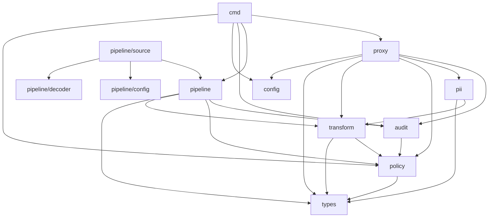

# Auvis Codebase Guide

This document maps every package in the `auvis-infra` to its purpose, lists the most important functions, and visualizes the dependency graph to help you quickly orient yourself within the codebase.

## Packages and Purposes

### `audit`
**Purpose:** Handles structured audit logging, secure log rotation, and provides HTTP handlers for sinking audit trails.
**Key Types:** Entry, Logger
**Key Functions:**
- `NewLogger`
- `NewRotatingLogger`
- `RegisterHandlers`
**Depends On:** nothing internal

### `cmd`
**Purpose:** Provides the CLI application and entrypoints to start the proxy, manage pipelines, and validate policies.
**Key Functions:**
- `Execute`

### `config`
**Purpose:** Loads and parses the global configuration needed for the proxy and server settings.
**Key Functions:**
- `LoadConfig`

### `pii`
**Purpose:** Scans and detects Personally Identifiable Information (PII) in payloads using both regex heuristics and LLM-based analysis.
**Key Types:** Entity, Scanner
**Key Functions:**
- `ScanLLM`
- `ScanRegex`
- `NewPlaceholderMap`
**Depends On:** nothing internal

### `pipeline`
**Purpose:** Core data processing engine that orchestrates reading from sources, applying policies/transformations, and writing to destinations.
**Key Types:** Pipeline, Record, Registry
**Key Functions:**
- `NewRegistry`
- `Run` (Starts Pipeline)
- `Pipeline.Run` (Internal execution)
**Depends On:** policy/, transform/, audit/

### `pipeline/config`
**Purpose:** Defines and loads configurations specific to asynchronous data pipelines, including environment variable resolution.
**Key Functions:**
- `LoadPipelineConfig`
- `ParsePipelineConfig`
- `ResolveEnvVars`

### `pipeline/decoder`
**Purpose:** Deserializes binary event streams (e.g., Avro, Protobuf) using external schema registries before processing.
**Key Functions:**
- `NewSchemaRegistryClient`
- `Decode`

### `pipeline/source`
**Purpose:** Implements upstream data integrations like Kafka consumers, manages dead-letter queues (DLQ), and reports metrics.
**Key Functions:**
- `NewKafkaSource`
- `NewDLQWriter`
- `ReportMetrics`

### `policy`
**Purpose:** Loads data protection policies, parses declarative conditions, and evaluates rules against request/record contexts.
**Key Types:** Policy, EffectivePolicy, Match, Rule
**Key Functions:**
- `NewStore`
- `EvaluateCondition`
- `Load`
**Depends On:** nothing internal

### `proxy`
**Purpose:** The core HTTP proxy interceptor that applies security rules and transforms HTTP request payloads on-the-fly.
**Key Types:** Handler, UserContext
**Key Functions:**
- `Handler`
- `ExtractContext`
**Depends On:** policy/, transform/, audit/, pii/

### `transform`
**Purpose:** Mutates sensitive data by applying masking, redaction, and truncation logic to payload fields.
**Key Types:** Summary, RuleAction
**Key Functions:**
- `NewApplyFn`
- `NewStreamApplyFn`
- `Apply`
**Depends On:** policy/, pii/

### `types`
**Purpose:** Provides common, shared data structures and interfaces used across the entire Auvis ecosystem.
**Key Functions:**
- *(Provides core structs such as `RequestContext` and `Summary`)*

## Dependency Graph

