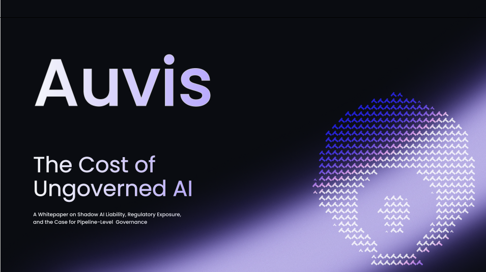

<div align="center">

# Auvis

**Policy enforcement for AI data pipelines.**

Govern your data before it reaches your AI — so your AI projects don't die in the security review.

[](https://golang.org)
[](LICENSE)
[](https://github.com/cridiv/Auvis/actions/workflows/ci.yml)
[](https://pkg.go.dev/github.com/cridiv/Auvis)
[](https://github.com/cridiv/Auvis/releases)

</div>



## The Problem

When companies build internal AI tools, they pull data from Confluence, Salesforce, Kafka, and databases — and feed it into vector databases or LLM context windows. The moment that happens, every access control from the source system disappears.

HR documents, salary records, customer PII, M&A discussions — all flattened into a vector database with no permissions, queryable by anyone with access to the AI tool.

> **Security teams block the project. Compliance teams have no audit trail. Legal says "not until someone proves GDPR compliance."**

Existing tools don't fix this:

| Tool Category | What they do | Why they miss this |
|---|---|---|
| **SQL Access Control** | Enforce access control for data warehouses (Snowflake, Databricks) | SQL analytics only — not ingestion pipelines |
| **LLM Gateways** | Filter prompts at inference time | Data is already in the vector DB by then |
| **Traditional DLP** | Watch email and network endpoints | Blind to internal data pipeline flows |
| **Data Catalogs** | Track data lineage and metadata | Documentation only, not runtime enforcement |

**Nobody enforces policies at the pipeline layer — between your source data and your AI system. That's Auvis.**

---

## What Auvis Does

Auvis sits inside your data ingestion pipelines and enforces your governance policies before data reaches a vector database, RAG system, or LLM.

```
Source Systems                    AI Infrastructure
──────────────────                ─────────────────────────
Confluence                        Vector DBs
SharePoint          ┌─────────┐   (Pinecone, Weaviate,
Kafka          ───► │  AUVIS  │ ──► pgvector, Qdrant)
PostgreSQL          │         │
Salesforce          └─────────┘   RAG Pipelines
S3 / GCS               │         LLM Context Windows
                        │
                   Audit Trail
                   Compliance Reports
```

**What happens inside Auvis on every record:**

1. **Policy evaluation** — match the record against your defined policies (<5ms)
2. **Field-level transformation** — mask, redact, pseudonymize, or drop sensitive fields
3. **ACL tag propagation** — carry source system permissions through to the vector index
4. **Decoupled Sinks / Fan-out** — stream governed records asynchronously to secondary sinks guarded by circuit breakers
5. **Audit logging** — record every decision, transformation, and policy match asynchronously

Zero changes to your AI application code.

---

## Features

### Policy Enforcement
- Field-level masking, redaction, tokenization, truncation, and removal
- Row-level filtering with dynamic condition evaluation (`==`, `!=`, `<`, `>`, `contains`, `in`)
- Fail-closed evaluation security (indeterminate conditions fail safe)
- Full-response deny with configurable alerting
- Priority-based conflict resolution — deterministic, always auditable
- Hot-reload — policy changes take effect in seconds without process restart

### PII Detection
- Built-in regex detection for high-frequency PII (Email, Phone, SSN, IPv4)
- Non-destructive placeholder mapping and pattern-preserving masking
- Extensible `pii.Scanner` interface for plugging in proprietary or custom classification models

### Access Control
- JWT claim extraction for user context (`user.region`, `user.role`, etc.)
- `X-User-*` header fallback for dev/simple deployments
- Wildcard role policies (`*`) as catch-all fallback rules
- Specificity-based precedence — explicit role always beats wildcard

### Destination Sinks & Decoupled Availability
- **Decoupled Proxy Availability**: Primary gateway governance is decoupled from secondary storage sinks. The client always receives their governed response (`HTTP 200 OK`) without latency degradation or blocking, even during downstream outages.
- **Circuit Breakers & Audit Visibility**: Independent 3-state circuit breakers (`Closed`, `Open`, `Half-Open`) guard every destination sink. If a destination write fails or trips to `Open`, Auvis fast-fails the write (`<0.1ms`), logs `slog.Warn`, and explicitly records `"destination_written": false` alongside `"destination_error": "<reason>"` in `audit.jsonl` for compliance reconciliation.
- **Pluggable Architecture**: Open interfaces for custom sink implementations (`pipeline.Destination`).

### Audit & Compliance
- Complete four-bucket field disposition per request: `fields_masked`, `fields_removed`, `fields_allowed`, `fields_denied`
- `response_denied` flag for full-response blocks
- PII category logging (`pii_types_detected`) — never raw values
- JSONL format — natively ingestible by Splunk, Datadog, ClickHouse, ELK
- Size-based and age-based log rotation
- Structured logging via Go `log/slog` throughout
- **Configurable Fsync Durability Modes**: Choose between maximum speed (`"never"` default, ~6,541 req/s), zero data loss (`"always"` for banking/compliance), or flexible periodic flushes (e.g. `"100ms"`, `"5s"`). See [ADR 001](docs/adr/001-audit-durability-fsync.md).

---

## Quick Start

### Prerequisites

- Go 1.22+
- Docker & Docker Compose (optional for local containerized deployment)

### Install

#### Option 1: Go Install (Instant CLI)
```bash
go install github.com/cridiv/Auvis@latest
```

#### Option 2: Docker Pull (Container Image)
```bash
docker pull ghcr.io/cridiv/auvis:latest
```

#### Option 3: Build from Source
```bash
git clone https://github.com/cridiv/Auvis.git
cd Auvis
go build -o auvis .
```

---

### Running Auvis

#### Start in dev mode:
```bash
# Start proxy pointing to your upstream API
AUVIS_UPSTREAM=http://your-upstream:8000 \
AUVIS_PORT=8082 \
./auvis dev
```

---

### Write Your First Policy

Create `policies/mask-pii.yaml`:

```yaml
# policies/mask-pii.yaml
policies:
  - name: mask-email-for-analysts
    description: Analysts see masked emails and masked phones only
    priority: 100
    compliance_tags: [GDPR, CCPA]
    match:
      roles: [analyst]
      resource: /users
    rules:
      - field: email
        action: mask
      - field: ssn
        action: remove
      - field: phone
        action: mask
```

Validate your policies before deploying:
```bash
./auvis validate --policies ./policies/
```

Send a test request through the proxy:
```bash
curl http://localhost:8082/users \
  -H "Authorization: Bearer <jwt>" \
  -H "X-Auvis-Upstream: http://your-upstream:8000"
```

The analyst receives:
```json
{
  "email": "***@example.com",
  "phone": "****7890",
  "ssn": null,
  "name": "Margaret Okonkwo"
}
```

And the audit log (`audit.jsonl`) records:
```json
{
  "timestamp": "2026-05-31T01:48:51Z",
  "user_id": "usr_101",
  "user_role": "analyst",
  "resource": "/users",
  "policies_applied": ["mask-email-for-analysts"],
  "fields_masked": ["email", "phone"],
  "fields_removed": ["ssn"],
  "fields_allowed": ["name", "id", "region"],
  "fields_denied": [],
  "response_denied": false,
  "pii_types_detected": ["EMAIL", "PHONE", "SSN"],
  "upstream_status": 200,
  "duration_ms": 10
}
```

---

## Documentation

- [Quickstart Guide](docs/quickstart.md) — 5-minute onboarding with the CLI and configuration.
- [Configuration Reference (`auvis.yaml`)](docs/configuration.md) — Comprehensive guide to gateway settings, streaming sources, and sinks.
- [Policy YAML DSL Reference](docs/policies.md) — Rules, actions (mask, remove, redact, truncate), and condition syntax.
- [CLI Command Reference](docs/cmd.md) — Complete guide to `auvis dev`, `init`, `validate`, `status`, and `logs`.
- [Audit & Compliance Logging](docs/audit.md) — Structured JSONL audit format, fsync durability modes, and compliance workflows.
- [Prometheus Metrics Reference](docs/metrics.md) — Telemetry counters, gauges, latency histograms, and Grafana dashboards.
- [WAN & Hybrid Cloud Deployment Guide](docs/wan_hybrid_guide.md) — Architecture patterns, consumer group offset rules, and WAN timeout tuning.
- [Threat Model & Security Architecture](docs/threat_model.md) — Security boundaries, fail-closed enforcement, and attack surface mitigations.

---

## Policy DSL

### Actions

| Action | What it does |
|---|---|
| `mask` | Pattern-preserving masking (`m.okonkwo@example.com` → `***@example.com`) |
| `remove` | Drop the field entirely |
| `redact` | Replace with `[REDACTED]` — hides length and format |
| `truncate` | Cut to N characters (rune-safe, UTF-8 aware) |
| `deny` | Block the entire response (403) |
| `allow` | Explicit passthrough — overrides wildcard deny |
| `llm_intercept` | Scan outbound request, mask PII, rehydrate in response |

### Pattern-Specific Masking

Auvis automatically detects field format and applies the right masking pattern:

```
Email:       m.okonkwo@example.com  →  ***@example.com
Phone:       +1-555-0198            →  ***-***-0198
SSN:         123-45-6789            →  ***-**-6789
IPv4:        192.168.1.100          →  192.168.1.***
```

### Conditions

Rules can be conditional — evaluated at runtime against the record and user context:

```yaml
rules:
  - field: salary
    action: mask
    condition: "user.role != 'hr'"

  - field: region_data
    action: remove
    condition: "record.region != user.region"

  - field: tags
    action: remove
    condition: "record.tags contains 'critical'"

  - field: clearance
    action: deny
    condition: "user.role in ['admin', 'auditor']"
```

* Supported operators: `==`, `!=`, `<`, `>`, `<=`, `>=`, `contains` (substring or array element matches), `in` (array literal check).
* Context variables: `user.fieldName` (from JWT), `record.fieldName` (from payload), `time.hour` (current UTC hour).
* **Fail-Closed Security**: If a condition cannot be evaluated due to missing variables or evaluation errors, Auvis strictly **fails closed**—the masking/removal rule is applied, or the record is excluded from arrays, and a warning is logged with Request ID to auditing.

### Wildcard Roles

```yaml
# Catch-all — deny everyone not explicitly permitted
- name: deny-unmatched
  match:
    roles: ["*"]
    resource: /users
  rules:
    - field: "*"
      action: deny

# Explicit — analysts get masked data (overrides wildcard)
- name: analyst-access
  priority: 100
  match:
    roles: [analyst]
    resource: /users
  rules:
    - field: email
      action: mask
```

Explicit role policies always beat wildcard policies. No priority number needed — specificity resolves it automatically.

---

## Ingestion Pipelines & Kafka (Built)

Auvis supports event-driven ingestion pipelines. A Kafka source connector is fully built and tested under `pipeline/source/kafka_source.go`.

**Kafka Source Features:**
- **Consumer Group Management**: Consumer coordination, offset resets (`earliest`, `latest`), and at-least-once commits.
- **Dead-Letter Queue (DLQ)**: Failed record fallback routing to prevent message processing failure from stalling ingestion.
- **Extensible Decoders**: Pluggable schema decoder interfaces for Avro and Protobuf.

---

## Configuration

```yaml
# auvis.yaml
version: "1"

gateway:
  port: 8082
  upstream: "http://your-service:8000"
  policies_dir: "./policies"
  audit_file: "./audit.jsonl"
  audit_max_size_mb: 100
  audit_fsync_interval: "never"    # "never" (6,541 req/s, default) | "always" | "100ms", "5s"
  upstream_timeout_seconds: 10

  circuit_breaker:
    max_failures: 5
    cooldown_seconds: 30

auth:
  jwt_secret: ${JWT_SECRET}
```

---

## CLI

```bash
auvis dev        # Start proxy with hot-reload and stdout logging
auvis validate   # Validate all policy files in the policies directory
auvis logs       # Tail and filter the audit log
auvis status     # Query running proxy health and metrics
auvis version    # Print version, git commit, build date
```

### Validate Output

```
┌─────────────────────────────────────────────────────┐
│ Auvis Policy Validation                             │
├─────────────────────────────────────────────────────┤
│ ✓ mask-email-for-analysts    priority:100  GDPR     │
│ ✓ deny-unmatched-roles       priority:0             │
│ ✓ remove-ssn-globally        priority:200  HIPAA    │
│                                                     │
│ 3 policies loaded, 0 errors, 0 warnings             │
└─────────────────────────────────────────────────────┘
```

---

## Performance

Benchmarked on a dev laptop (Apple M-series) against a Go upstream server:

| Metric | Result |
|---|---|
| Requests/sec | 6,541 |
| Average latency | 7.6ms |
| p50 | 5.9ms |
| p95 | 18.1ms |
| Fastest single request | 0.2ms |
| Error rate (400,000 requests) | 0% |

The proxy's own processing overhead is sub-millisecond. End-to-end latency is dominated by upstream response time.

This figure is **3.8× higher than the v0.1.0 baseline of 1,710 req/sec**, achieved via four optimizations in v0.2.6:
1. `httputil.ReverseProxy` is cached per upstream URL via `sync.Map` instead of being rebuilt on every request.
2. Response buffers are reused across requests via `sync.Pool`.
3. Per-request and per-record `slog.Info` calls in the transform hot path were downgraded to `slog.Debug`, eliminating log-writer mutex contention.
4. The audit logger's per-entry `fsync` was decoupled to configurable durability modes.

*Tested with `hey -n 400000 -c 50` sustained over 60 seconds with full policy enforcement (field masking, PII scanning, audit logging) against a Go mock upstream.*

---

## Architecture

```
┌──────────────────────────────────────────────────────────┐
│                    AUVIS GATEWAY                         │
│                                                          │
│  ┌─────────────┐   ┌──────────────┐   ┌──────────────┐  │
│  │   Context   │   │   Policy     │   │  Transform   │  │
│  │  Resolver   │──►│   Engine     │──►│   Engine     │  │
│  │             │   │              │   │              │  │
│  │ JWT claims  │   │ Compiled     │   │ mask/remove  │  │
│  │ X-User-*    │   │ decision     │   │ redact/      │  │
│  │ headers     │   │ tree (<5ms)  │   │ truncate     │  │
│  └─────────────┘   └──────────────┘   └──────┬───────┘  │
│                                               │          │
│  ┌────────────────────────────────────────────┤          │
│  │              PII SCANNER                   │          │
│  │  Email | Phone | SSN | IPv4 Regex Scanner  │          │
│  │  (Enterprise: LLM Fallback & Check Digits) │          │
│  └────────────────────────────────────────────┘          │
│                                               │          │
│  ┌────────────────────────────────────────────┼──────────┐
│  │         DESTINATION SINKS (PIPELINE)       │          │
│  │  Pluggable Destination Interfaces          │          │
│  │  Circuit Breakers (Closed/Open/Half-Open)  │          │
│  │  (Enterprise: Postgres/pgvector/Weaviate)  │          │
│  └────────────────────────────────────────────┤          │
│                                               │          │
│  ┌────────────────────────────────────────────┘          │
│  │              AUDIT ENGINE                             │
│  │  Async JSONL writer — never blocks hot path          │
│  │  Four-bucket field disposition per request           │
│  │  Size + age-based log rotation                       │
│  │  Configurable fsync durability modes                 │
│  └──────────────────────────────────────────────────────┘
└──────────────────────────────────────────────────────────┘
```

---

## Roadmap

**v0.1.0 — Complete ✓**
- HTTP reverse proxy with policy enforcement
- Basic PII detection and masking
- Transform engine (mask, remove, redact, truncate, deny, allow, llm_intercept)
- Row-level filtering with condition evaluation
- JWT + header context resolution
- Wildcard role policies with specificity precedence
- Async audit logger with log rotation
- Hot-reload, `auvis validate` CLI

**v0.2.5 — Complete ✓**
- Ingestion pipeline abstraction layer (`Source` -> `Policy` -> `Transform` -> `Destination`)
- Circuit breaker pattern for destination sinks (`Closed`, `Open`, `Half-Open`)
- Robust sandboxed Condition Evaluator (`contains`, `in`, `time.hour` support, with fail-closed security for indeterminate states)
- Kafka source connector driver (built and tested with Schema Registry interfaces, DLQ, offset commit support)
- Docker support (`Dockerfile`)

**v0.2.6 — Complete ✓**
- Reverse proxy cache — `httputil.ReverseProxy` built once per upstream URL via `sync.Map`
- Response buffer pool — `bytes.Buffer` reused across requests via `sync.Pool`, cutting GC pressure under concurrent load
- Hot-path log levels — per-request and per-record `slog.Info` calls downgraded to `slog.Debug`, eliminating log-writer mutex contention
- Audit logger — decoupled disk durability modes (`never`, `always`, duration)
- Throughput: **6,541 req/sec** sustained over 400,000 requests

**v0.3.0 — Planned**
- Python SDK (`PipelineGuard`)
- TypeScript SDK (`@auvis/sdk`)
- S3 / Blob storage audit sinks
- Additional open-source source connectors

---

## Who Is Auvis For

**The AI project team blocked by security**
Your RAG system works great in the demo. Then the CISO asks "how do we know customer PII isn't being embedded in that vector database?" Auvis is your answer.

**The CISO with no visibility**
AI projects are happening — officially and unofficially. Auvis gives you a single place to define policies and an audit trail to show regulators.

**The compliance team without proof**
GDPR requires data minimization. HIPAA requires PHI access logs. PCI-DSS requires cardholder data controls. Auvis generates the audit proof.

---

## Open Source Commitment

Auvis is an open-source-first project licensed under [Apache 2.0](LICENSE).

- **Open Source Forever**: The core gateway proxy, policy evaluation engine, transformation pipeline, PII scanner, row-level filtering, and structured audit logging are open source and will remain free and open forever.
- **Enterprise Capabilities**: Advanced clinical/financial check-digit patterns, zero-shot LLM contextual scanning, and pre-built managed vector database connectors are offered as part of Auvis Enterprise.

---

## License

Apache 2.0 — see [LICENSE](LICENSE)

---

<div align="center">
<sub>Auvis — your data is already governed. Now keep it that way when it reaches your AI.</sub>
</div>
