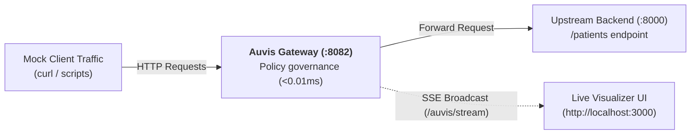

Auvis includes a built-in interactive healthcare demonstration stack (`auvisDemo`) to showcase real-time policy evaluation, HIPAA data governance, and live audit telemetry.

---

## Architecture of the Demo Stack



1. **Zero Client Code Changes**: Client applications send standard HTTP requests to `http://localhost:8082/patients`. No SDKs are installed in the client application.
2. **Upstream Backend**: The mock backend in `test-cmd/main.go` returns raw patient bundles containing SSNs, medical notes, emails, and diagnosis codes.
3. **Auvis Gateway**: Intercepts the traffic, strips SSNs, masks emails and phone numbers, pseudonymizes patient IDs, and records an audit event in `audit.jsonl`.
4. **Live Visualizer**: Streams governance events in real-time over `/auvis/stream` to display before-and-after payload diffs.

---

## Running the Demo Step-by-Step

### 1. Start Upstream Server
```bash
cd test-cmd
go run main.go
# Listening on http://localhost:8000
```

### 2. Start Auvis Gateway
```bash
# In the repository root:
auvis dev
# Listening on http://localhost:8082
```

### 3. Send Requests as Different Roles

#### As a Doctor:
```bash
curl -s -H "X-User-Role: doctor" \
        -H "X-User-ID: doc_301" \
        http://localhost:8082/patients | jq .
```
*Doctor role receives medical records with SSNs removed, but clinical notes and diagnostic codes intact.*

#### As an Analyst:
```bash
curl -s -H "X-User-Role: analyst" \
        -H "X-User-ID: ana_102" \
        http://localhost:8082/patients | jq .
```
*Analyst role receives pseudonymized patient IDs, masked emails, and clinical notes completely redacted.*

