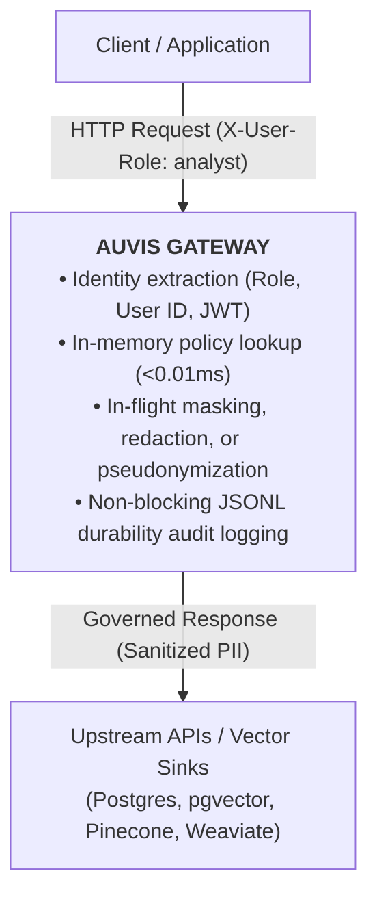

When companies build internal AI tools, they pull data from databases, Confluence, Salesforce, and streaming topics — and feed it directly into vector databases or LLM context windows. The moment that happens, **every access control from the source system disappears**.

HR documents, salary records, customer PII, and healthcare records are flattened into vector embeddings with zero permissions, queryable by anyone with access to the AI tool.

<Callout type="warning" title="The AI Security Bottleneck">
Security teams block the project. Compliance teams have no audit trail. Legal says "not until someone proves GDPR/HIPAA compliance."
</Callout>

Existing tooling does not solve this:
* **SQL Access Controls** (e.g. Immuta, Privacera) only monitor data warehouses, not streaming ingestion pipelines.
* **LLM Guardrails** filter user prompts at inference time, but sensitive data is already embedded in the vector DB by then.
* **Traditional DLP** is blind to high-throughput internal microservice data flows.
* **Data Catalogs** document lineage, but do not provide runtime enforcement.

**Auvis sits at the pipeline layer — between your source data and your AI infrastructure — to enforce policies in real-time.**

---

<MetricGrid>
  <MetricCard label="Governance Latency" value="<0.01ms" sub="in-memory compiled policy graph evaluation" />
  <MetricCard label="Zero Code Changes" value="Reverse Proxy" sub="drop-in HTTP gateway or Kafka consumer" />
  <MetricCard label="Availability" value="Decoupled" sub="circuit breakers protect sink outages" />
</MetricGrid>

---

## How Auvis Works

Auvis operates in two primary modes:

### 1. In-Flight Reverse Proxy Mode
Auvis sits between client applications and backend microservices or LLM APIs. When a request arrives:
1. **Identity Extraction**: Extracts user identity and role from headers (`X-User-Role`, `X-User-ID`), JWT bearer tokens, or Identity Providers (IdP).
2. **Compile-Time Graph Lookup**: Matches the request against pre-compiled policy rules in microseconds.
3. **Stream Transformation**: Masks emails, removes SSNs, pseudonymizes IDs with SHA-256 salts, or truncates strings.
4. **Destination Fan-Out**: Synchronously writes governed records and vector embeddings to downstream sinks (`pgvector`, Pinecone, Weaviate).
5. **Non-Blocking Audit**: Appends an immutable JSONL audit record with compliance tags (`HIPAA`, `GDPR`).

### 2. Continuous Streaming Pipeline Mode
Auvis runs as a native Kafka/Redpanda consumer group worker. It reads raw streaming records, applies governance policies, and routes sanitized records into storage sinks before downstream consumers or RAG retrieval pipelines can access them.

---

## Core Guarantees

* **Fail-Closed Governance**: If an evaluation fails or an unauthorized user requests protected fields without a policy, data is withheld or masked by default.
* **Zero Client Code Changes**: Applications send standard HTTP requests through Auvis; no custom SDKs or client library migrations are required.
* **Decoupled Sink Availability**: Independent 3-state circuit breakers protect storage sinks. If a vector database is down, client responses are delivered without blocking.
* **Zero-Downtime Hot Reload**: Edit any YAML policy file in `policies/` and changes take effect immediately across all worker goroutines without restarting the gateway.

---

## Next Steps

* Follow the **[5-Minute Quickstart](/docs/quickstart)** to spin up Auvis locally with your first policy.
* Learn how to write fine-grained governance rules in the **[Policy DSL Reference](/docs/policies)**.
* Check out the **[Configuration Reference](/docs/configuration)** for `auvis.yaml` options.

