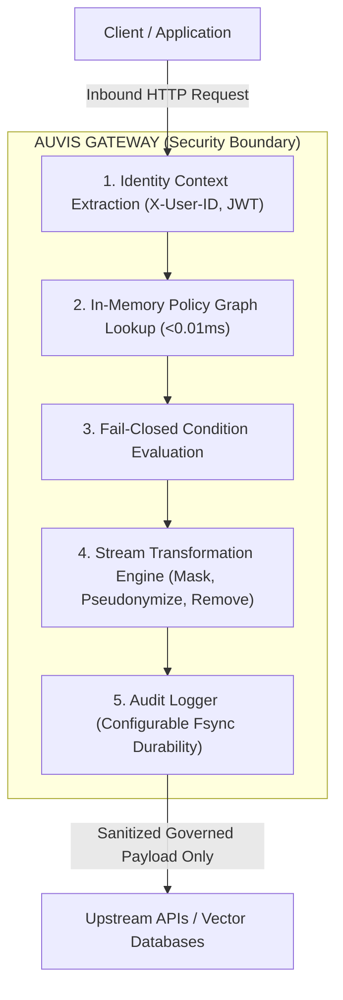

This document details the threat model, security boundaries, and architectural guarantees enforced by the Auvis Gateway.

---

## Security Boundaries & Core Principles

---

## Threat Vectors & Mitigations

### 1. Ingestion of Sensitive Data into AI Embeddings
* **Threat**: Client applications push raw patient notes, credit card numbers, or internal salaries into vector databases. Once embedded, similarity searches expose unredacted text to any RAG query.
* **Mitigation**: Auvis intercepts requests in-flight before they reach vector storage. Fields matching sensitive tags or policy rules are masked or stripped from the payload, guaranteeing vector stores only index governed records.

### 2. Header Spoofing (`X-User-Role`, `X-User-ID`)
* **Threat**: Malicious clients pass arbitrary `X-User-Role: admin` headers to bypass field restrictions.
* **Mitigation**: In production environments, Auvis strips incoming identity headers unless verified by a cryptographic JWT signature or configured Identity Provider (`AUVIS_IDP_URL`). Upstream target headers are always stripped before forwarding.

### 3. Fail-Open vs Fail-Closed (`AUVIS_ENV`)
* **Threat**: A policy condition fails to evaluate because an expected user attribute is missing from the request context.
* **Mitigation**: Auvis strictly evaluates conditions as **fail-closed**:
  * Missing attribute in field condition → Rule fires anyway (data is masked/removed).
  * Missing attribute in row filter condition → Row is dropped from the array.
  * In `AUVIS_ENV=production`, shadow PHI defaults to `auto_mask` to prevent accidental data leaks.

### 4. Storage Sink Failures & Cascading Outages
* **Threat**: A destination vector database goes offline, causing gateway requests to back up, exhaust memory buffers, and crash the proxy.
* **Mitigation**: Every storage sink is protected by an independent 3-state circuit breaker (`Closed`, `Open`, `Half-Open`). If write failures exceed `max_failures`, the breaker trips to `Open` and fast-fails writes in `<0.1ms`, preserving proxy availability while recording `"destination_written": false` in the audit trail.

