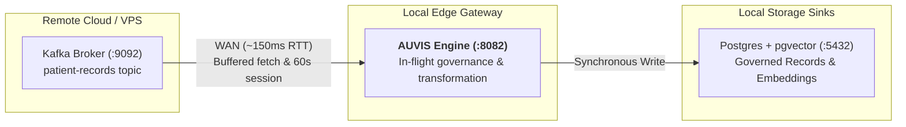

This guide details best practices for deploying the **Auvis Gateway** in hybrid cloud topologies — specifically where Auvis runs locally or at the edge (on-premise, edge cluster, edge gateway) while streaming data to or from remote services (cloud Kafka brokers, database clusters) across high-latency Wide Area Network (WAN) links.

---

## Hybrid Streaming Architecture Overview

In a typical hybrid setup:
1. **Upstream Source**: A Kafka cluster running on a remote cloud instance or VPS (e.g. AWS, GCP, Azure).
2. **Privacy Gateway**: Auvis running locally on an edge server or local environment (`:8082`).
3. **Governance Sinks**: Local database instances (Postgres with `pgvector`, Pinecone, Weaviate) or downstream cloud applications.



---

## WAN Configuration Best Practices (`auvis.yaml`)

When streaming across high-latency internet links (~100ms–200ms round-trip time), default consumer timeouts built for local-network VPC environments (sub-1ms latency) can cause consumer rebalance stalls.

Apply the following tuned settings under `sources.settings` in `auvis.yaml`:

```yaml
sources:
  - type: kafka
    settings:
      brokers: "13.63.117.156:9092"
      topic: "patient-records"
      group_id: "auvis-hybrid-prod-v1"
      auto_offset_reset: "latest"
      max_wait_ms: "500"             # Caps fetch wait time to prevent short polling loops over WAN
      session_timeout_ms: "60000"    # 60s consumer group session timeout
      heartbeat_interval_ms: "5000"  # 5s heartbeat interval to group coordinator
      rebalance_timeout_ms: "30000"  # 30s group rebalance assignment timeout
      commit_interval: "1s"          # At-least-once offset commit frequency
```

### Parameter Explanations

| Setting | Recommended WAN Value | Local Network Default | Purpose |
|---|---|---|---|
| `session_timeout_ms` | `60000` (60s) | `30000` (30s) | Prevents the Kafka Group Coordinator from evicting Auvis during multi-message WAN fetch delays. |
| `heartbeat_interval_ms` | `5000` (5s) | `3000` (3s) | Maintains active group membership while keeping network overhead minimal. |
| `rebalance_timeout_ms` | `30000` (30s) | `30000` (30s) | Allows sufficient time for all consumers to synchronize partition assignments over WAN. |
| `max_wait_ms` | `500` (500ms) | `100` (100ms) | Prevents rapid short-polling loops over high-latency links by buffering fetches for up to 500ms. |
| `commit_interval` | `1s` | `0s` (disabled) | Ensures offsets are committed periodically back to Kafka for at-least-once ingestion proof. |

---

## Consumer Group Offset Management Rules

### 1. `auto_offset_reset` Behavior
* `auto_offset_reset: "latest"` **only takes effect when a consumer group has NO committed offsets** on the Kafka broker.
* If you re-use an existing `group_id` that previously processed records, Kafka ignores `auto_offset_reset` and resumes fetching from the last committed offset.

### 2. Skipping Legacy Backlogs
If a Kafka topic contains hundreds of thousands of legacy records, force-reset the consumer group offsets to latest:

```bash
kafka-consumer-groups.sh \
  --bootstrap-server 13.63.117.156:9092 \
  --group auvis-hybrid-prod-v1 \
  --reset-offsets --to-latest --execute \
  --topic patient-records
```
