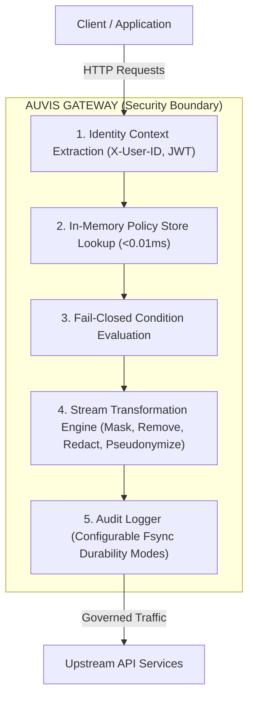

# Auvis Threat Model & Security Architecture

This document details the threat model, security boundaries, and architectural trade-offs enforced by the Auvis API Security & Policy Enforcement Gateway.

---

## 🛡️ Security Boundaries & Core Principles

---

## 1. Runtime-vs-Compile-Time Distinction

Auvis strictly separates **policy compilation** from **runtime request enforcement**:

### Compile-Time Phase (Startup & Hot-Reload Watcher)
* Policy YAML files in `policies/` are parsed, validated, and compiled into an optimized in-memory lookup graph (`*policy.Store`).
* Syntax errors, invalid actions, or malformed regex patterns abort compilation cleanly before any traffic is served.
* Hot-reload directory watching (`fsnotify`) compiles replacement stores atomically using RCU (Read-Copy-Update) mutex swapping (`s.swap(next)`), ensuring zero lock contention or thread blocking.

### Runtime Phase (Hot-Path Request Execution)
* Every incoming HTTP request undergoes identity context extraction and in-memory policy lookup.
* **Zero Database / Zero Network Dependencies:** Policy lookup executes strictly against the compiled in-memory graph in $<0.01\text{ ms}$.
* No per-request SQL or Redis queries take place, eliminating external network latency and database outage risks from the core proxy path.

---

## 2. Fail-Open vs Fail-Closed Trade-Offs

Auvis enforces strict, explicit security trade-offs depending on the component context:

| Component | Default Strategy | Trade-off Rationale |
|---|---|---|
| **Condition Evaluation** | **Fail-Closed** | If a policy condition expression (`record.status == 'active'`) cannot be evaluated due to missing request context attributes (e.g. missing `user.clearance`), Auvis treats the state as indeterminate and **fails closed** (the rule is enforced or the record is excluded) to prevent data leaks. A `slog.Warn` warning is logged to auditing. |
| **Identity Authentication** | **Fail-Closed** | Requests missing required identity headers (`X-User-ID`, `X-User-Role`) or valid tokens are rejected immediately with `HTTP 401 Unauthorized`. |
| **Secondary Destination Writes** | **Decoupled (Fail-Closed Audit, Fail-Open Client)** | If a secondary storage sink (e.g. Pinecone vector database) experiences an outage or trips its circuit breaker, Auvis logs `"destination_written": false` in `audit.jsonl` but proceeds to deliver the governed payload (`200 OK`) to the client. This prevents third-party database outages from crashing primary client API availability. |

---

## 3. Fsync & Durability Security Trade-offs (ADR 001)

Auvis provides configurable disk durability modes (`audit_fsync_interval`) to let operators tune the trade-off between maximum request throughput and zero-data-loss compliance guarantees:

| Mode | Throughput | Durability Guarantee | Recommended Use Case |
|---|---|---|---|
| `"never"` (default) | **~6,541 req/sec** | Uses OS file caching. Disk flushes occur asynchronously on buffer completion or graceful shutdown. | Maximum performance, high-throughput microservices. Potential loss of in-flight buffer on sudden OS kernel crash. |
| `"always"` | **~1,700 req/sec** | Synchronous `f.Sync()` per entry. Zero data loss. | High-compliance environments (PCI-DSS, HIPAA, SEC). Guarantees audit record is on physical disk before HTTP response finishes. |
| `"100ms"`, `"500ms"`, `"5s"` | **~5,500 req/sec** | Spawns a background `time.Ticker` to flush disk buffers periodically. | Balanced trade-off for medium-traffic clusters. Maximum potential data loss bounded to configured ticker duration (e.g. max 100ms). |

---

## 4. Keyed One-Way Pseudonymization Security

* **No Reversible Vault:** `action: pseudonymize` produces deterministic, format-preserving pseudonyms using `HMAC-SHA256(seed, value)`.
* **Zero Secret Storage:** There is no token vault or database storing mappings between original PII and pseudonyms, rendering it immune to vault breach attacks.
* **Per-Rule Seed Isolation:** Operators can specify custom `seed` overrides per rule (`seed: "dept-patients-2026"`), preventing cross-department correlation attacks.
