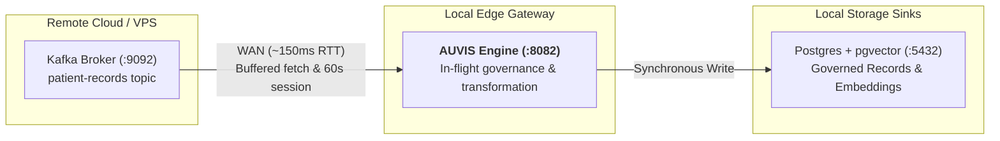

# AUVIS WAN & Hybrid Cloud Deployment Guide

This guide details best practices for deploying the **AUVIS Data Privacy Gateway** in hybrid cloud topologies — specifically where AUVIS runs locally or at the edge (on-premise, edge gateway, local container) while streaming data to or from remote services (Kafka brokers, database clusters) across high-latency Wide Area Network (WAN) links.

---

## 🌐 Hybrid Streaming Architecture Overview

In a typical hybrid setup:
1. **Upstream Source**: A Kafka cluster running on a remote cloud instance or VPS (e.g. `13.63.117.156:9092`).
2. **Privacy Gateway**: AUVIS running locally on an edge server or local environment (`:8082`).
3. **Governance Sinks**: Local database instances (Postgres with `pgvector`, Pinecone, Weaviate) or downstream cloud applications.



---

## ⚙️ WAN Configuration Best Practices (`auvis.yaml`)

When streaming across high-latency internet links (~100ms–200ms round-trip time), default consumer timeouts built for local-network VPC environments (<1ms latency) can cause consumer rebalance stalls.

Apply the following tuned settings under `sources.settings` in `auvis.yaml`:

```yaml
sources:
  - type: kafka
    settings:
      brokers: "13.63.117.156:9092"
      topic: "patient-records"
      group_id: "auvis-hybrid-prod-v1"
      auto_offset_reset: "latest"
      max_wait_ms: "500"             # Caps fetch wait time to prevent short polling loops over WAN
      session_timeout_ms: "60000"    # 60s consumer group session timeout (prevents eviction during WAN fetches)
      heartbeat_interval_ms: "5000"  # 5s heartbeat interval to group coordinator
      rebalance_timeout_ms: "30000"  # 30s group rebalance assignment timeout
      commit_interval: "1s"          # At-least-once offset commit frequency
```

### Parameter Explanations

| Setting | Recommended WAN Value | Local Network Default | Purpose |
|---|---|---|---|
| `session_timeout_ms` | `60000` (60s) | `30000` (30s) | Prevents the Kafka Group Coordinator from evicting AUVIS during multi-message WAN fetch delays. |
| `heartbeat_interval_ms` | `5000` (5s) | `3000` (3s) | Maintains active group membership while keeping network overhead minimal. |
| `rebalance_timeout_ms` | `30000` (30s) | `30000` (30s) | Allows sufficient time for all consumers to synchronize partition assignments over WAN. |
| `max_wait_ms` | `500` (500ms) | `100` (100ms) | Prevents rapid short-polling loops over high-latency links by buffering fetches for up to 500ms. |
| `commit_interval` | `1s` | `0s` (disabled) | Ensures offsets are committed periodically back to Kafka for at-least-once ingestion proof. |

---

## 🧭 Consumer Group Offset Management Rules

### 1. `auto_offset_reset` Behavior
* `auto_offset_reset: "latest"` **only takes effect when a consumer group has NO committed offsets** on the Kafka broker.
* If you re-use an existing `group_id` that previously processed records, Kafka ignores `auto_offset_reset` and resumes fetching from the last committed offset.

### 2. Skipping Legacy Backlogs
If a Kafka topic contains hundreds of thousands of legacy records (e.g. historical unindexed FHIR bundles):
* **Option A (Fresh Group ID)**: Change `group_id` to a new string (e.g. `auvis-hybrid-v2`). Because zero offsets exist for the new group, AUVIS starts cleanly from the latest log tip.
* **Option B (Kafka CLI Offset Reset)**: Run the following command on the Kafka broker to force-reset offsets to the end of the topic log:
  ```bash
  kafka-consumer-groups --bootstrap-server localhost:9092 \
    --group my-group-id \
    --topic my-topic \
    --reset-offsets --to-latest --execute
  ```

---

## 🛢️ Vector Destination Prerequisites (`pgvector`)

When configuring vector storage sinks (`pgvector`, `pinecone`, `weaviate`), AUVIS extracts vector embeddings from the payload to populate `vector(N)` columns.

### Requirements:
1. **Payload Schema**: Ingested records **must** include the designated `vector_field` specified in `auvis.yaml` (e.g. `"embedding": [0.12, -0.45, 0.89]`).
2. **Dimension Match**: The length of the float slice must match `vector_dim` configured in `auvis.yaml` (e.g. `vector_dim: "3"`).
3. **Database Extension**: For `pgvector`, AUVIS automatically executes `CREATE EXTENSION IF NOT EXISTS vector;` if `auto_create_table: "true"`.

```yaml
destinations:
  - type: pgvector
    settings:
      host: "localhost"
      port: "5432"
      dbname: "auvis_demo"
      table: "governed_vectors"
      vector_field: "embedding"
      vector_dim: "3"
      auto_create_table: "true"
      sslmode: "disable"
    auth:
      username: "auvis"
      password: "auvis-password"
```

---

## 🔍 Troubleshooting WAN Pipeline Issues

| Symptom | Probable Cause | Resolution |
|---|---|---|
| AUVIS logs startup cleanly, but DB count stays at 0 | Re-used `group_id` is reading legacy backlog from `CURRENT-OFFSET`. | Switch to a fresh `group_id` or run `--reset-offsets --to-latest`. |
| Consumer enters continuous rebalance loops | Network latency caused `session_timeout_ms` to expire. | Increase `session_timeout_ms: "60000"` and `heartbeat_interval_ms: "5000"`. |
| `audit.jsonl` entries show `"destination_written": false` | Vector destination missing required `embedding` payload field. | Ensure payload records contain the configured `vector_field` array. |
| `bind: address already in use` at startup | Stale AUVIS process listening on port 8082. | Kill stale process with `kill $(lsof -ti :8082)`. |
